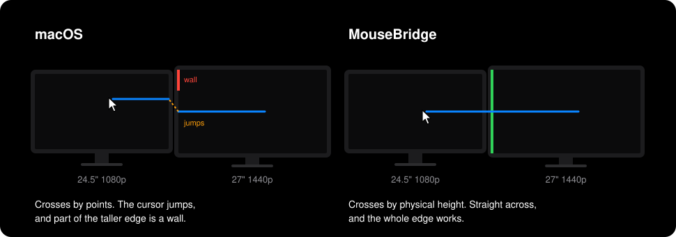
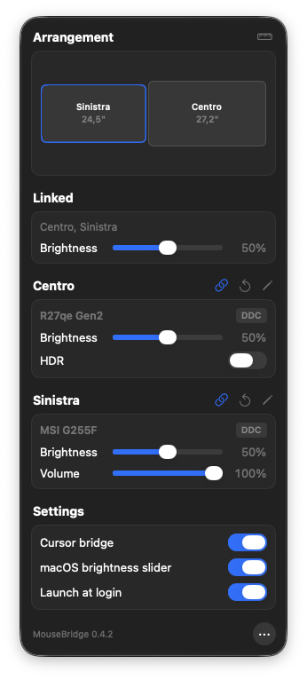
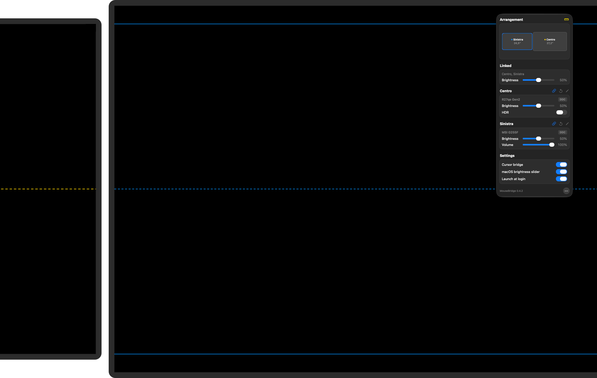

<div align="center">

# MouseBridge

**Mixed monitors, one desk.**<br>
Your cursor crosses between displays at the height it physically is, and every display gets brightness in the menu bar, plus volume and HDR where it supports them.

[](https://github.com/RealDoc06/mousebridge/releases/latest)  

[**Download**](https://github.com/RealDoc06/mousebridge/releases/latest)

<br>



</div>

## Why

macOS moves the cursor between displays by points. Put a 27" 1440p next to a 24.5" 1080p and the cursor jumps up or down every time it crosses, and the taller edge has a wall in the wrong place. MouseBridge reads each display's physical size and maps crossings to the same physical height, so the cursor goes straight across like the displays were one, and walls off only the strip past the shorter display's bezels.

## Features



**Cursor bridge.** Left and right crossings land at the same physical height. Past a shorter display's top or bottom, the taller display's edge is a wall. A display stacked above or below the row (an iPad under a monitor) is entered only where it physically sits.

**Real-scale arrangement.** The menu draws your displays at their true size. Drag one to match the desk, nudge it a pixel with the arrow keys, or drag past a neighbor to reorder it in macOS.

**Alignment guides.** The ruler button draws guides on the real displays where the other displays' edges and centers fall, each display in its own color, so you can line them up with the bezels.

**Brightness that just works.** DDC/CI when the display answers, software dimming when it doesn't (common behind USB-C to HDMI adapters), an overlay for Sidecar. The brightness keys adjust the display under the cursor, Option+Shift for fine steps.

**Native macOS slider.** Optionally, compatible DDC displays get the same brightness slider in Control Center and System Settings that Apple displays have.

**Linked displays.** Link displays to change their brightness together, from any member's slider, keys, or Control Center.

**HDR and volume.** Toggle HDR where supported, set volume on displays that report speakers over DDC.

**Auto updates.** Signed, notarized, and updated through Sparkle.

<br clear="right">

## Line them up

Turn on the guides and drag until the lines meet the bezels. Each display marks the other's edges and center, at physical scale.



## Install

1. Download the latest zip from [Releases](https://github.com/RealDoc06/mousebridge/releases/latest), unzip it, and move **MouseBridge** to Applications.
2. Open it and grant **Accessibility** when asked. It runs the cursor bridge and the brightness keys. If they don't start, use **Relaunch** in the menu.
3. Open the menu bar icon and drag your displays to match the desk.

Requires macOS 14 or later and Apple Silicon.

## Good to know

- **macOS brightness slider** (Settings) publishes a virtual brightness device and gives the display a virtual EDID. The display goes black for a moment while macOS picks it up, again after a reboot or reconnect. Displays whose EDID already has a ContainerID, and identical displays with no serial number, keep MouseBridge's own slider and keys.
- **macOS arrangement.** MouseBridge moves side-by-side displays up or down in macOS's arrangement to match the desk, so macOS crosses only where the displays physically meet and stops the cursor at the walls itself. If the shorter display has as many points as the taller one, macOS can't match the desk, and those strips cross onto the nearest row instead.
- **Sidecar and other virtual displays** ignore gamma, so they're dimmed with a click-through overlay. An iPad's own backlight stays set on the iPad.
- **Scope.** The bridge handles side-by-side displays and displays stacked on them. Other vertical crossings, like inside a 2×2 grid, are left to macOS.

## Develop

```sh
swift test               # cursor mapping tests
scripts/build-app.sh     # signed build/MouseBridge.app
scripts/release.sh       # next patch (v0.4.0 -> 0.4.1): tag, build, notarize, sign appcast, publish GitHub release
```

Releases need the Sparkle EdDSA key at `~/.config/mousebridge/sparkle_ed25519` (`SPARKLE_KEY`) and a notarytool keychain profile named `mousebridge` (`NOTARY_PROFILE`). The Control Center slider needs the HID Virtual Device entitlement, which `signing/MouseBridge.provisionprofile` (Developer ID, team 2JT7745BQ2) grants.
